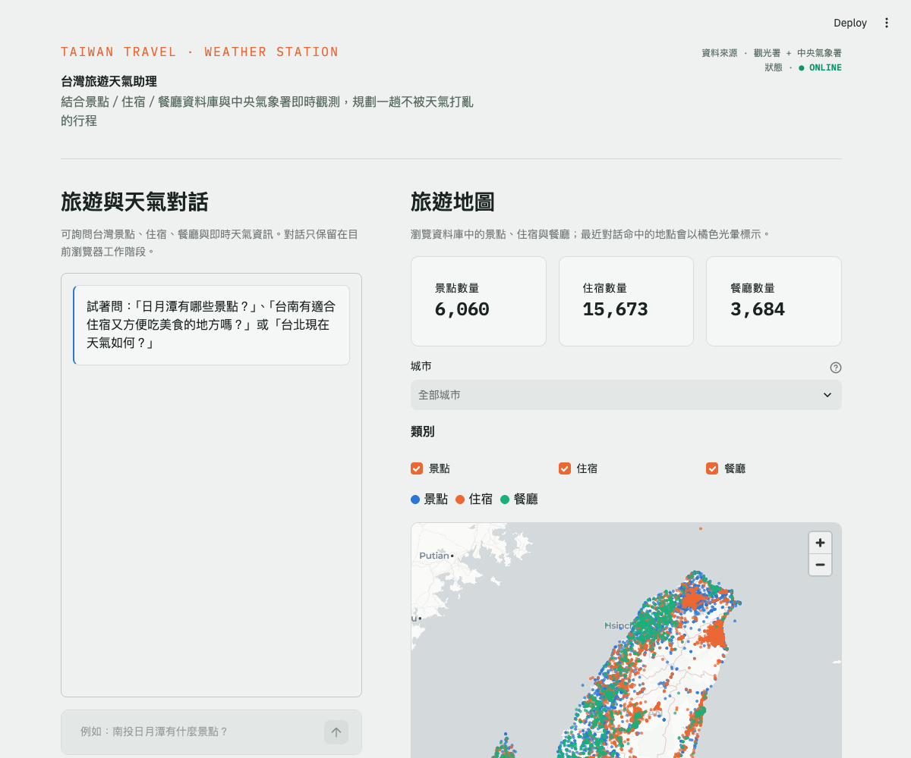
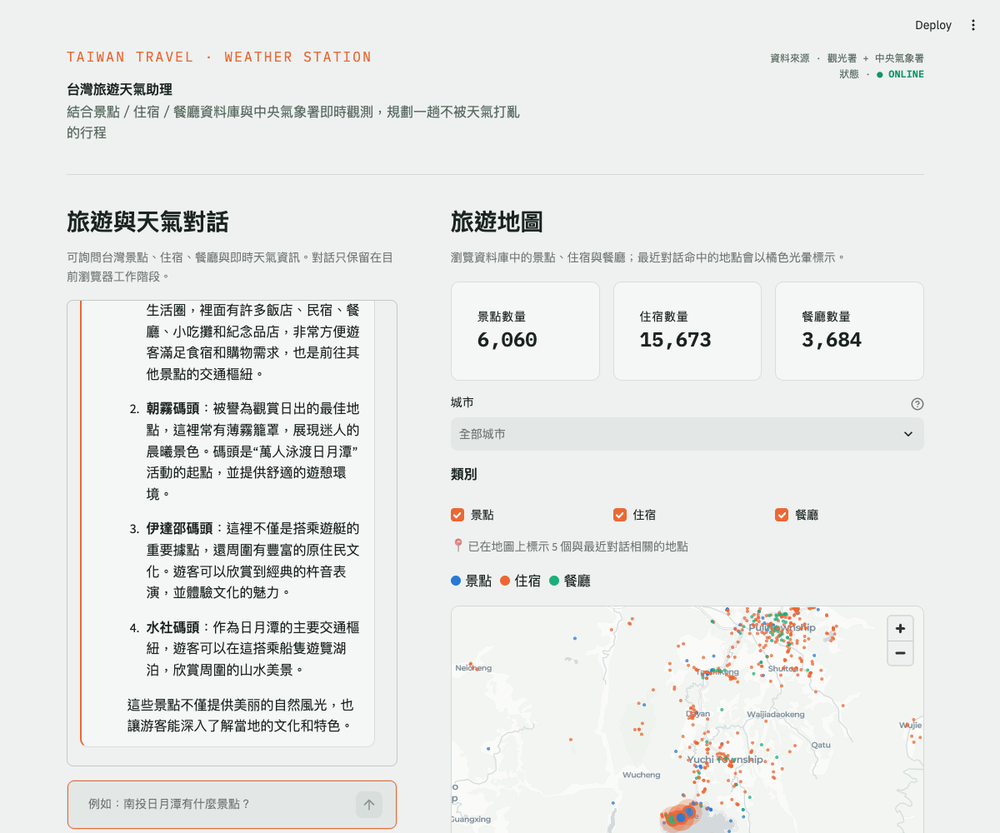
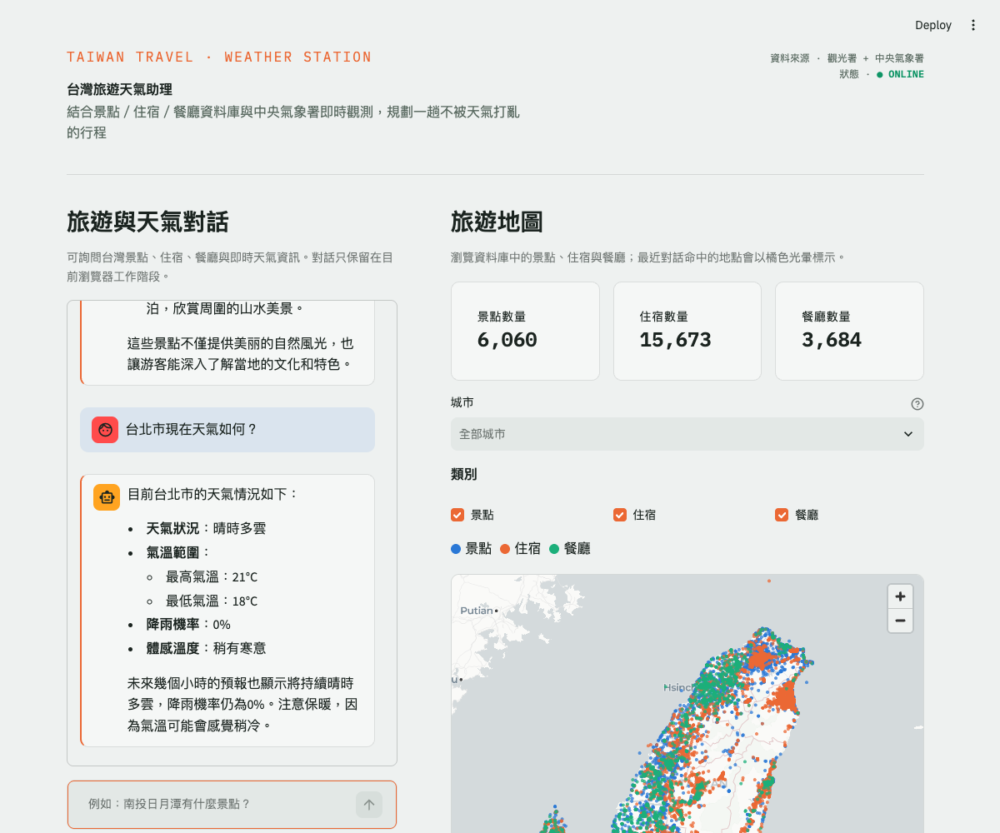

# weatherLLM

天氣感知的台灣旅遊助理：使用者用自然語言提問（例如「南投日月潭有什麼景點？」「台北市現在有沒有生效中的天氣特報？」），系統用一個 ReAct agent 判斷要查旅遊資料（RAG）還是查天氣（MCP），整合後回答，並在地圖上標出推薦的地點。

- **旅遊資料**：觀光署景點／住宿／餐飲開放資料，存進 SQLite，再建 Chroma 向量索引與 BM25 索引，用 Hybrid Search + Reranker 檢索。
- **天氣資料**：透過 `cwa-mcp-server`（中央氣象署開放資料的 MCP 工具，PyPI 套件）即時查詢。
- **Agent**：LangGraph `create_react_agent`，單一 agent，最多 5 個工具（1 個 RAG + 4 個天氣；天氣為選用，沒有金鑰時只剩 RAG）。
- **介面**：Streamlit，對話與地圖並排。
- **工程化**：Docker 單一 container、GitHub Actions CI（pytest + image build）與 CD（pytest 通過後推到 GHCR）。
- **使用方式**：可直接使用下方的線上試用站，或在自己的電腦用 Python 或 Docker 執行。

## 線上試用

**[weatherllm-hpes8wsx4xalrwfvawbzgq.streamlit.app](https://weatherllm-hpes8wsx4xalrwfvawbzgq.streamlit.app/)**（Streamlit Community Cloud，免費方案閒置會休眠，第一次開啟可能要等一下）。

- 對話需要在側邊欄填入**你自己的 OpenAI API Key**（只保存在你目前的工作階段記憶體，不寫入磁碟）。
- 想查**即時天氣**，可在側邊欄選填**氣象署 API 金鑰**（到[氣象資料開放平臺](https://opendata.cwa.gov.tw/)免費註冊取得）；有填就優先使用你的金鑰，沒填且展示站沒有預設金鑰時，只能詢問景點、住宿與餐廳。

## 畫面預覽

以下是在本機執行的實際畫面。

**對話與地圖並排**：左邊問答，右邊地圖顯示資料庫裡的景點（藍）、住宿（橘）、餐廳（綠）。



**問景點**：「南投日月潭有什麼景點？」，回答會列出景點；最近一次對話命中的地點，會在地圖上以橘色光暈標示。



**問天氣**：「台北市現在天氣如何？」，由中央氣象署資料經天氣工具查詢後回答。



## 整體資料流

```
【離線：建立資料，只在更新資料時手動跑（或直接下載預先建好的資料包）】
  觀光署資料集(7777/7780/7779) ─┐
  TDX公車/YouBike/停車場(選用) ─┼─> collector/fetch_*.py ─> Data/travel.db (SQLite)
                                 │         └─> link_*.py、derive_district_coords.py(衍生欄位/關聯表)
                                 └─> collector/build_embeddings.py ─> Data/chroma/ + Data/bm25_index.pkl

【線上：每次提問】
  使用者 ─> Streamlit(code/app.py) ─> WeatherAgent(code/agent.py, ReAct, gpt-4o-mini)
              ├─ 旅遊問題 ─> search_travel_info ─> rag.py ─> hybrid_search.py(BM25+向量+RRF) ─> reranker_fn.py ─> Top-5
              ├─ 天氣問題 ─> mcp_tools.py ─> cwa-mcp-server(子程序，stdio) ─> 中央氣象署API (含45分鐘TTL快取)
              └─ 防線：recursion_limit=10、單thread累計成本上限US$0.08、RAG失敗硬覆寫、prompt injection防護
            回答 + 命中的地點doc_ids ─> 對話區顯示、地圖標示
```

## 目錄

| 路徑 | 內容 |
|---|---|
| `code/` | 線上執行的程式：`app.py`（UI）、`agent.py`、`mcp_tools.py`、`rag.py`、`hybrid_search.py`、`reranker_fn.py`，以及 pytest 測試與 smoke test |
| `code/rag_quality/` | RAG 評估集建立與執行（ragas） |
| `collector/` | 離線資料收集與索引建置腳本 |
| `Data/` | 產出的資料（SQLite、Chroma、BM25、模型快取）。產出物不進 git，可下載 Release 的資料包或自己跑 collector 重建 |
| `Dockerfile`、`docker-compose.yml`、`warmup_fastembed.py`、`.dockerignore` | 容器化 |
| `.github/workflows/` | `ci.yml`、`cd.yml` |

## 環境變數（放在專案根目錄的 `.env`，範本見 `.env.example`）

| 變數 | 誰提供 | 用途 | 沒有會怎樣 |
|---|---|---|---|
| `CWA_API_KEY` | 操作者（免費申請，選填） | 傳給 `cwa-mcp-server` 查天氣；使用者在側邊欄填了自己的金鑰時，優先用使用者的 | 沒有時只提供旅遊問答，天氣查詢會說明無法使用 |
| `OPENAI_API_KEY` | 網頁使用者在側邊欄自己貼 | LLM 呼叫（`gpt-4o-mini`） | 網頁不讓 agent 執行。命令列的 smoke test 與 eval 才從環境變數讀 |
| `TDX_CLIENT_ID`、`TDX_CLIENT_SECRET` | 操作者（免費會員） | 只有 `collector/fetch_transit.py` 用 | 不跑交通資料收集就不需要 |
| `WEATHERLLM_RERANK` | 選用 | 設為 `0` 時略過重排序模型（輕量模式），記憶體從約 3.7GB 降到約 0.8GB | 預設啟用重排序 |
| `WEATHERLLM_DATA_URL`、`WEATHERLLM_DATA_SHA256` | 選用 | 自訂資料包的下載網址與對應的 SHA-256（64 位十六進位，兩者要一起設） | 預設用本 repo 的 Release |
| `LANGFUSE_PUBLIC_KEY`、`LANGFUSE_SECRET_KEY`、`LANGFUSE_HOST` | 操作者（選用） | 可觀測性 trace | 沒設定就不送 trace，不影響功能 |

`.env` 已被 `.gitignore` 與 `.dockerignore` 排除，不會進 git 或 image。

## 從零開始跑起來

需求：Python 3.11 以上（專案用 3.11.15；`cwa-mcp-server` 要求 Python ≥ 3.11）。以下指令都在專案根目錄執行。

```bash
# 1. 建環境、裝套件（requirements.txt 全部釘版本）
python3.11 -m venv .venv
source .venv/bin/activate
pip install -r requirements.txt

# 2. 設定金鑰
cp .env.example .env      # 然後編輯 .env 填入 CWA_API_KEY 等

# 3. 取得資料（Data/ 裡的資料庫與索引不在版控裡）。最快的方式：下載預先建好的資料包（約 90MB，已驗證校驗碼）
python3 code/bootstrap_data.py
#    或自己從來源重新建立（順序有依賴）：
python3 collector/fetch_tourism.py              # 景點/住宿/餐飲 -> Data/travel.db（免key，每日更新）
python3 collector/derive_district_coords.py     # 行政區中心點（依賴上一步的資料）
python3 collector/build_embeddings.py           # 全量重建 Chroma + BM25 索引（會下載本地模型，需幾分鐘）

# 選用（目前UI/RAG用不到，是資料層保留的內容）：交通站與關聯表
python3 collector/fetch_transit.py              # 需要 TDX_CLIENT_ID/SECRET；內建每13秒節流，耗時長
python3 collector/link_transit.py               # 注意：會刪除沒被任何景點/住宿引用的交通站
python3 collector/link_lodging_attraction.py

# 4. 驗證資料與檢索
python3 code/smoke_test_rag.py                  # 22縣市 + 邊界案例；失敗時 exit code 非0

# 5. 啟動介面
streamlit run code/app.py                       # 開 http://localhost:8501，在側邊欄貼自己的 OpenAI key
```

## 測試

```bash
(cd code && pytest -q)         # 全部 mock，不打真實 API、不需金鑰與 Data/
python3 code/smoke_test_agent.py   # 真實 OpenAI + CWA（會花錢）：多輪對話、多需求、guardrail、天氣工具
python3 code/smoke_test_rag.py     # 需要建好的 Data/（見上）
python3 code/rag_quality/run_eval.py --eval-set eval_set_v2.json   # RAG 評估（ragas，會呼叫 OpenAI）
```

CI 只跑 `pytest -q` 與 Docker image build；smoke test 與 RAG eval 需要真實金鑰或本機資料，不在 CI 裡。

## Docker

```bash
docker compose up --build       # 以 Dockerfile 現場 build 並啟動，http://localhost:8501
docker compose pull             # 或拉 CD 推到 GHCR 的 image（ghcr.io/gary2376/weatherllm:latest）
```

重點：image 裡**沒有** `Data/`；`docker-compose.yml` 會把主機的 `Data/chroma`、`Data/travel.db`、`Data/bm25_index.pkl` 掛進 container，所以**要先在主機完成上面第 3 步**。這三個路徑在主機上不存在時，Docker 會建出空目錄頂替，container 看起來正常、查詢卻查不到資料。在 Mac 用 colima 時，專案若放在外接磁碟，需 `colima start --mount /Volumes/<磁碟名>:w`。

## 部署到 Streamlit Community Cloud

app 啟動時若找不到 `Data/`，會自動從本 repo 的 Release 下載資料包，所以不需要把資料放進 repo。

1. 到 [share.streamlit.io](https://share.streamlit.io) 用 GitHub 登入，選 **Create app**，指定本 repo、分支 `master`、主檔案 `code/app.py`。
2. **Advanced settings**：Python 版本選 **3.11**；在 **Secrets** 填入

   ```toml
   CWA_API_KEY = "你的中央氣象署金鑰"   # 選填；不填的話訪客要自己填金鑰才能查天氣
   WEATHERLLM_RERANK = "0"
   ```

3. 部署後，使用者在側邊欄貼上自己的 OpenAI API Key 就能對話（金鑰只存在該使用者的工作階段）。

免費方案的記憶體上限約 2.7GB（[官方說明](https://docs.streamlit.io/streamlit-community-cloud/manage-your-app)，可能隨時變動），完整模式約 3.7GB 放不下，所以雲端要設 `WEATHERLLM_RERANK = "0"`（輕量模式實測約 0.8GB）。輕量模式直接取混合檢索（BM25 + 向量）的前 5 筆，不再用重排序模型精選，排序品質略低。

## 授權

程式碼以 [MIT License](LICENSE) 授權。旅遊與交通**資料**（觀光署、TDX）不放在 git 原始碼裡，可由 Release 的資料包取得或自行用 collector 建立，各自的授權與顯名要求見 [`DATA_LICENSE.md`](DATA_LICENSE.md)。
